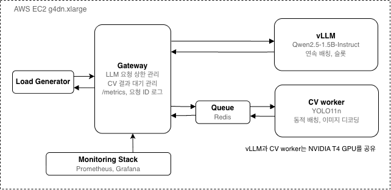

# System Architecture: Multi-Model AI 추론 운영 인프라

LLM은 동기 스트리밍, CV는 비동기 큐와 워커의 배치 처리로 경로를 분리하고, 두 모델 서버가 GPU 한 장을 나눠 씁니다.

## 1. Serving 구조

게이트웨이 하나가 모든 요청을 받아 워크로드별 경로로 분기합니다.

| 구성 요소 | 역할 |
| --- | --- |
| 게이트웨이 (FastAPI, asyncio) | 단일 진입점. 워크로드별 분기, LLM 동시 처리 제한, CV 작업 투입과 결과 대기 |
| vLLM | LLM 서빙. continuous batching, OpenAI 호환 API |
| Redis | CV 작업 큐, 결과 전달, 워커 생존 신호(heartbeat) |
| CV 워커 | 큐에서 작업을 꺼내 배치로 디코딩(CPU)과 추론(GPU) |
| Prometheus · Grafana | 지표 수집, 경보 평가, 대시보드 |

- 처리 경로를 분리해, 수 초 걸리는 LLM 요청과 수십 ms 걸리는 CV 요청이 같은 대기열에서 서로를 기다리지 않습니다.
- CV 워커는 게이트웨이와 별도 프로세스이므로, 워커를 늘리거나 재시작해도 게이트웨이는 계속 요청을 받습니다.

## 2. 요청 처리 방식

| 항목 | LLM: 동기 스트리밍 | CV: 비동기 큐 + 워커 |
| --- | --- | --- |
| 선택 이유 | 사용자가 첫 토큰을 빨리 받아야 함 | 짧은 요청이 몰려도 큐가 흡수. 워커 장애가 게이트웨이로 번지지 않음 |
| 흐름 | 게이트웨이 → vLLM → 생성된 토큰을 SSE로 즉시 전달 | 게이트웨이가 작업을 큐에 넣고 결과 키를 대기(BLPOP) → 워커가 꺼내 배치 처리 후 결과 기록 → 게이트웨이가 응답 |
| 배치 처리 | continuous batching: 스텝마다 끝난 요청을 빼고 새 요청을 넣어 함께 계산(슬롯 32) | 마이크로 배칭: 최대 8장 또는 10 ms까지 모아 한 번에 추론 |
| 과부하 시 | 동시 64개를 넘는 요청은 게이트웨이에서 대기, 30초 초과 시 503 | 큐 길이 상한 초과 시 429, 결과가 60초 안에 없으면 504 |
