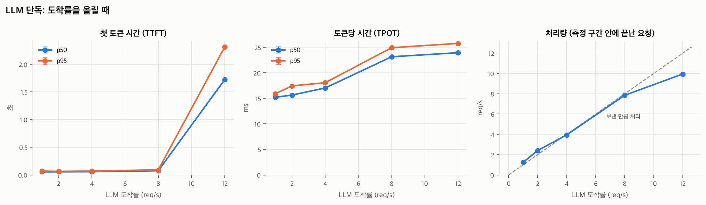
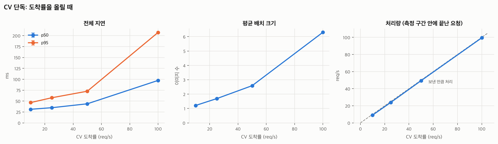
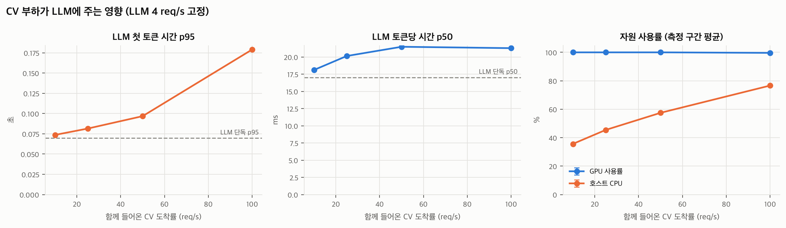
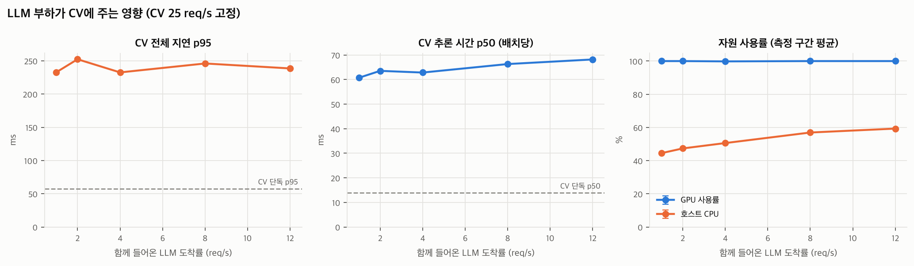

# 실험 결과: d3-pilot

- 시작: 2026-11-09T07:46:54 · 커밋: `74b779b` · GPU: GPU 0: Tesla T4 (UUID: GPU-4107237a-437b-a600-d1ce-71c94993b1be)
- 단계당 워밍업 5초 + 측정 20초, 반복 1회, 도착 간격 포아송
- 표의 값은 반복 평균이고, 괄호는 반복 간 최소~최대입니다. 지연 백분위는 요청별 기록에서 직접 계산했습니다.
- 실패한 단계: 0개

## LLM 단독

**12 req/s에서 지연 급증**: TTFT p95가 가장 낮은 도착률의 33.3배 (69 → 2,313 ms). 처리 한계에 가까워진 신호입니다.

| 도착률 (req/s) | 처리량 | TTFT p50 (ms) | TTFT p95 (ms) | TPOT p50 (ms) | e2e p95 (ms) | 에러율 | GPU % | 호스트 CPU % | 서버 처리 중 최대 | 서버 내부 대기 최대 | KV cache 최대 % |
| --- | --- | --- | --- | --- | --- | --- | --- | --- | --- | --- | --- |
| 1.0 | 1.25 | 56 | 69 | 15.2 | 2,084 | 0.000 | 99 | 17 | 7 | 0 | 0.8 |
| 2.0 | 2.40 | 56 | 65 | 15.7 | 2,278 | 0.000 | 100 | 16 | 10 | 0 | 1.2 |
| 4.0 | 3.95 | 58 | 70 | 17.0 | 2,355 | 0.000 | 100 | 20 | 15 | 0 | 1.6 |
| 8.0 | 7.85 | 76 | 92 | 23.2 | 3,249 | 0.000 | 100 | 26 | 32 | 0 | 3.7 |
| 12.0 | 9.95 | 1,724 | 2,313 | 23.9 | 5,546 | 0.000 | 100 | 28 | 32 | 23 | 3.9 |

## CV 단독

**100 req/s에서 지연 급증**: 전체 지연 p95가 가장 낮은 도착률의 4.5배 (47 → 207 ms). 처리 한계에 가까워진 신호입니다.

| 도착률 (req/s) | 처리량 | p50 (ms) | p95 (ms) | p99 (ms) | 큐 대기 p95 (ms) | 추론 p50 (ms) | 해독 p50 (ms) | 평균 배치 | 에러율 | GPU % | 호스트 CPU % |
| --- | --- | --- | --- | --- | --- | --- | --- | --- | --- | --- | --- |
| 10.0 | 9.05 | 31 | 47 | 56 | 11 | 12.8 | 3.1 | 1.21 | 0.000 | 1 | 11 |
| 25.0 | 23.90 | 35 | 58 | 229 | 19 | 13.9 | 4.1 | 1.69 | 0.000 | 5 | 17 |
| 50.0 | 49.35 | 44 | 73 | 87 | 25 | 16.0 | 7.0 | 2.59 | 0.000 | 12 | 26 |
| 100.0 | 99.45 | 97 | 207 | 255 | 128 | 31.3 | 20.0 | 6.31 | 0.000 | 23 | 42 |

## 경합: LLM 4 req/s 고정 + CV 증가

| CV 도착률 | LLM TTFT p95 (ms) | LLM TPOT p50 (ms) | LLM e2e p95 (ms) | CV 처리량 | CV p95 (ms) | CV 에러율 | GPU % | 호스트 CPU % |
| --- | --- | --- | --- | --- | --- | --- | --- | --- |
| 0 (LLM 단독) | 70 | 17.0 | 2,355 | - | - | - | 100 | 20 |
| 10.0 | 74 | 18.1 | 2,637 | 9.05 | 133 | 0.000 | 100 | 36 |
| 25.0 | 81 | 20.1 | 2,949 | 24.00 | 230 | 0.000 | 100 | 45 |
| 50.0 | 97 | 21.5 | 3,322 | 45.50 | 1,720 | 0.000 | 100 | 57 |
| 100.0 | 179 | 21.3 | 3,348 | 9.60 | - | 1.000 | 100 | 77 |

## 경합: CV 25 req/s 고정 + LLM 증가

| LLM 도착률 | CV p95 (ms) | CV 추론 p50 (ms) | CV 해독 p50 (ms) | CV 큐 대기 p95 (ms) | CV 에러율 | LLM TTFT p95 (ms) | LLM 처리량 | GPU % | 호스트 CPU % |
| --- | --- | --- | --- | --- | --- | --- | --- | --- | --- |
| 0 (CV 단독) | 58 | 13.9 | 4.1 | 19 | 0.000 | - | - | 5 | 17 |
| 1.0 | 233 | 60.7 | 8.8 | 83 | 0.000 | 69 | 1.25 | 100 | 45 |
| 2.0 | 252 | 63.6 | 9.0 | 95 | 0.000 | 82 | 2.40 | 100 | 47 |
| 4.0 | 233 | 62.9 | 8.7 | 86 | 0.000 | 83 | 4.10 | 100 | 51 |
| 8.0 | 246 | 66.3 | 9.6 | 102 | 0.000 | 306 | 7.80 | 100 | 57 |
| 12.0 | 239 | 68.2 | 9.8 | 103 | 0.000 | 5,859 | 8.45 | 100 | 59 |

## 200이 아닌 응답이 있었던 단계

측정 구간에 보낸 요청 중 실패한 것의 상태별 건수입니다. 504는 게이트웨이가 CV 결과를 기다리다 한도(`CV_WAIT_TIMEOUT_S`)를 넘긴 것, 503은 LLM 동시성 대기 한도를 넘긴 것, timeout은 부하 생성기 쪽 한도입니다.

| 시나리오 | 회차 | LLM 도착률 | CV 도착률 | 워크로드 | 상태별 건수 |
| --- | --- | --- | --- | --- | --- |
| mixed-cv-sweep | 1 | 4.0 | 100.0 | CV | 500×1748, conn_error×231 |

## 그래프

