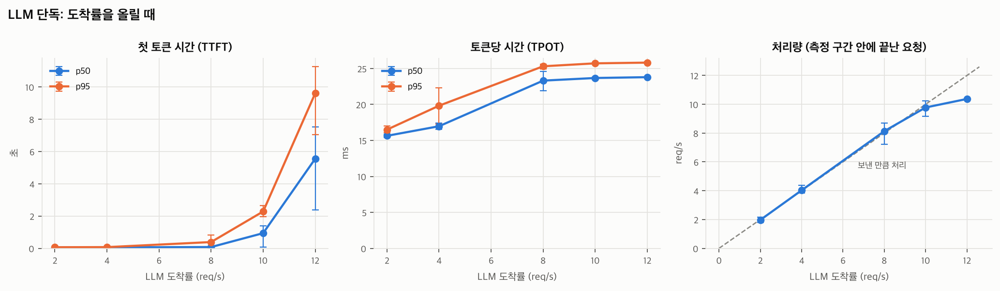
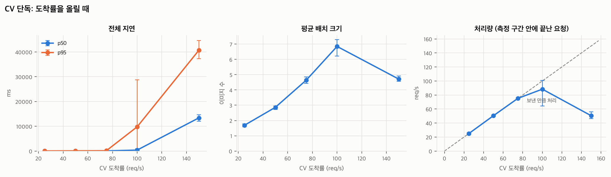
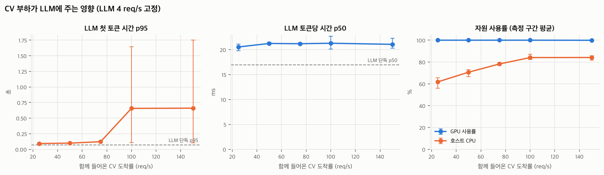
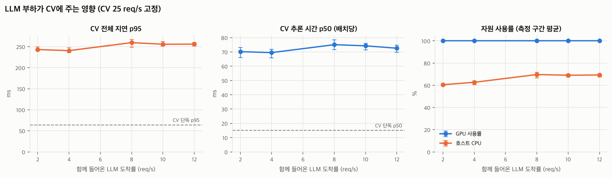

# 실험 결과: d3

- 시작: 2026-11-09T08:13:33 · 커밋: `74b779b` · GPU: GPU 0: Tesla T4 (UUID: GPU-4107237a-437b-a600-d1ce-71c94993b1be)
- 단계당 워밍업 10초 + 측정 45초, 반복 3회, 도착 간격 포아송
- 표의 값은 반복 평균이고, 괄호는 반복 간 최소~최대입니다. 지연 백분위는 요청별 기록에서 직접 계산했습니다.
- 실패한 단계: 0개

## LLM 단독

**8 req/s에서 지연 급증**: TTFT p95가 가장 낮은 도착률의 5.9배 (66 → 388 ms). 처리 한계에 가까워진 신호입니다.

| 도착률 (req/s) | 처리량 | TTFT p50 (ms) | TTFT p95 (ms) | TPOT p50 (ms) | e2e p95 (ms) | 에러율 | GPU % | 호스트 CPU % | 서버 처리 중 최대 | 서버 내부 대기 최대 | KV cache 최대 % |
| --- | --- | --- | --- | --- | --- | --- | --- | --- | --- | --- | --- |
| 2.0 | 1.97 (1.80~2.18) | 53 (51~57) | 66 (59~78) | 15.6 (15.4~15.9) | 2,155 (2,099~2,213) | 0.000 | 97 (96~100) | 31 (22~37) | 8 | 0 | 0.9 |
| 4.0 | 4.03 (3.84~4.38) | 58 (52~61) | 74 (62~82) | 17.0 (16.6~17.4) | 2,586 (2,247~2,907) | 0.000 | 100 (100~100) | 36 (27~41) | 17 | 0 | 2.0 |
| 8.0 | 8.13 (7.22~8.69) | 78 (71~84) | 388 (92~833) | 23.3 (21.9~24.6) | 3,556 (3,263~4,023) | 0.000 | 100 | 42 (32~47) | 32 | 3 | 3.6 |
| 10.0 | 9.78 (9.16~10.22) | 939 (80~1,402) | 2,283 (1,959~2,635) | 23.7 (23.4~23.8) | 5,404 (4,971~5,738) | 0.000 | 100 | 43 (36~47) | 32 | 23 | 3.8 |
| 12.0 | 10.37 (10.33~10.40) | 5,551 (2,385~7,507) | 9,607 (7,039~11,247) | 23.8 (23.8~23.8) | 12,747 (10,301~14,351) | 0.000 | 100 | 43 (37~46) | 32 | 32 | 3.8 |

## CV 단독

**100 req/s에서 포화**: 측정 구간 안에 끝난 요청이 보낸 요청의 88%뿐 (보냄 100.13, 처리 88.28 req/s). 이 지점부터 줄이 계속 길어집니다.

| 도착률 (req/s) | 처리량 | p50 (ms) | p95 (ms) | p99 (ms) | 큐 대기 p95 (ms) | 추론 p50 (ms) | 해독 p50 (ms) | 평균 배치 | 에러율 | GPU % | 호스트 CPU % |
| --- | --- | --- | --- | --- | --- | --- | --- | --- | --- | --- | --- |
| 25.0 | 25.03 (24.40~25.82) | 38 (35~41) | 65 (58~70) | 80 (71~88) | 21 (18~24) | 15.2 (13.9~16.6) | 4.7 (4.0~5.2) | 1.69 (1.59~1.78) | 0.000 | 6 (6~6) | 33 (25~38) |
| 50.0 | 50.40 (49.62~51.31) | 50 (46~53) | 90 (83~94) | 109 (100~114) | 31 (28~33) | 18.2 (16.8~19.1) | 8.3 (7.1~8.9) | 2.86 (2.73~2.95) | 0.000 | 11 (11~12) | 43 (36~48) |
| 75.0 | 75.15 (74.64~75.69) | 73 (66~78) | 128 (122~135) | 164 (155~174) | 53 (49~57) | 23.7 (22.2~25.3) | 14.4 (13.2~15.2) | 4.64 (4.43~4.86) | 0.000 | 17 (16~17) | 51 (45~55) |
| 100.0 | 88.28 (64.40~100.80) | 386 (125~874) | 9,779 (231~28,807) | 12,372 (279~36,495) | 302 (149~546) | 37.2 (36.2~38.9) | 25.0 (23.8~26.6) | 6.85 (6.23~7.30) | 0.046 | 19 (14~22) | 61 (55~65) |
| 150.0 | 50.31 (46.24~55.98) | 13,384 (12,070~14,659) | 40,673 (37,300~44,587) | 54,639 (50,817~58,262) | 242 (156~337) | 28.0 (26.5~30.5) | 16.3 (14.8~18.7) | 4.71 (4.56~4.92) | 0.630 | 10 (9~12) | 66 (63~69) |

## 경합: LLM 4 req/s 고정 + CV 증가

| CV 도착률 | LLM TTFT p95 (ms) | LLM TPOT p50 (ms) | LLM e2e p95 (ms) | CV 처리량 | CV p95 (ms) | CV 에러율 | GPU % | 호스트 CPU % |
| --- | --- | --- | --- | --- | --- | --- | --- | --- |
| 0 (LLM 단독) | 74 (62~82) | 17.0 (16.6~17.4) | 2,586 (2,247~2,907) | - | - | - | 100 (100~100) | 36 (27~41) |
| 25.0 | 93 (77~102) | 20.5 (19.8~21.1) | 3,185 (2,734~3,542) | 24.97 (24.29~25.73) | 245 (237~254) | 0.000 | 100 | 62 (56~65) |
| 50.0 | 99 (92~104) | 21.2 (21.1~21.5) | 3,295 (3,050~3,515) | 35.85 (22.44~45.69) | 4,709 (4,246~4,945) | 0.261 | 100 | 71 (67~73) |
| 75.0 | 123 (117~128) | 21.2 (21.0~21.4) | 3,292 (3,038~3,511) | 1.31 (0.73~2.18) | - | 1.000 | 100 | 78 (77~79) |
| 100.0 | 657 (111~1,645) | 21.3 (20.1~22.7) | 3,592 (3,090~4,594) | 11.22 (0.00~30.98) | 30,130 (8,976~51,283) | 0.851 | 100 | 84 (82~87) |
| 150.0 | 660 (107~1,754) | 21.1 (20.3~22.3) | 3,694 (3,175~4,576) | 19.72 (0.00~31.40) | 55,663 (54,957~56,370) | 0.831 | 100 (100~100) | 84 (82~86) |

## 경합: CV 25 req/s 고정 + LLM 증가

| LLM 도착률 | CV p95 (ms) | CV 추론 p50 (ms) | CV 해독 p50 (ms) | CV 큐 대기 p95 (ms) | CV 에러율 | LLM TTFT p95 (ms) | LLM 처리량 | GPU % | 호스트 CPU % |
| --- | --- | --- | --- | --- | --- | --- | --- | --- | --- |
| 0 (CV 단독) | 65 (58~70) | 15.2 (13.9~16.6) | 4.7 (4.0~5.2) | 21 (18~24) | 0.000 | - | - | 6 (6~6) | 33 (25~38) |
| 2.0 | 243 (240~249) | 70.2 (66.0~73.0) | 9.9 (9.1~10.6) | 93 (93~94) | 0.000 | 76 (74~77) | 1.97 (1.80~2.16) | 100 | 61 (60~61) |
| 4.0 | 241 (236~247) | 69.5 (65.9~71.9) | 10.0 (9.2~10.6) | 94 (93~95) | 0.000 | 85 (83~90) | 4.07 (3.89~4.40) | 100 | 63 (61~64) |
| 8.0 | 260 (248~267) | 75.1 (71.7~78.5) | 10.7 (9.7~11.6) | 104 (99~107) | 0.000 | 1,754 (685~3,318) | 7.79 (7.09~8.36) | 100 | 70 (67~72) |
| 10.0 | 256 (251~262) | 74.3 (71.4~76.1) | 11.1 (10.2~11.7) | 102 (101~103) | 0.000 | 8,240 (5,221~10,280) | 8.73 (8.67~8.82) | 100 | 69 (68~70) |
| 12.0 | 256 (251~260) | 72.6 (69.8~74.7) | 10.6 (9.6~11.5) | 102 (101~102) | 0.000 | 17,829 (15,219~19,547) | 8.79 (8.71~8.87) | 100 | 69 (67~70) |

## 200이 아닌 응답이 있었던 단계

측정 구간에 보낸 요청 중 실패한 것의 상태별 건수입니다. 504는 게이트웨이가 CV 결과를 기다리다 한도(`CV_WAIT_TIMEOUT_S`)를 넘긴 것, 503은 LLM 동시성 대기 한도를 넘긴 것, timeout은 부하 생성기 쪽 한도입니다.

| 시나리오 | 회차 | LLM 도착률 | CV 도착률 | 워크로드 | 상태별 건수 |
| --- | --- | --- | --- | --- | --- |
| cv-only | 1 | - | 150.0 | CV | dropped×4092 |
| mixed-cv-sweep | 1 | 4.0 | 75.0 | CV | 500×2884, conn_error×470 |
| mixed-cv-sweep | 1 | 4.0 | 100.0 | CV | 500×3856, conn_error×686 |
| mixed-cv-sweep | 1 | 4.0 | 150.0 | CV | dropped×3474, 500×3278, conn_error×28 |
| cv-only | 2 | - | 150.0 | CV | dropped×4708 |
| mixed-cv-sweep | 2 | 4.0 | 50.0 | CV | 500×1133, conn_error×136 |
| mixed-cv-sweep | 2 | 4.0 | 75.0 | CV | 500×2914, conn_error×489 |
| mixed-cv-sweep | 2 | 4.0 | 100.0 | CV | dropped×2732 |
| mixed-cv-sweep | 2 | 4.0 | 150.0 | CV | dropped×5591, 500×61 |
| cv-only | 3 | - | 100.0 | CV | dropped×616 |
| cv-only | 3 | - | 150.0 | CV | dropped×4523 |
| mixed-cv-sweep | 3 | 4.0 | 50.0 | CV | 500×493, conn_error×34 |
| mixed-cv-sweep | 3 | 4.0 | 75.0 | CV | 500×2879, conn_error×499 |
| mixed-cv-sweep | 3 | 4.0 | 100.0 | CV | 500×3569, dropped×950, conn_error×36 |
| mixed-cv-sweep | 3 | 4.0 | 150.0 | CV | dropped×5337 |

> 주의: 일부 단계에서 부하 생성기가 요청을 예정보다 늦게 보냈습니다 (send_lag p99 최대 4762 ms). 부하 생성기 자체가 바빴던 구간이라 해당 단계 해석에 주의하세요.

## 그래프

